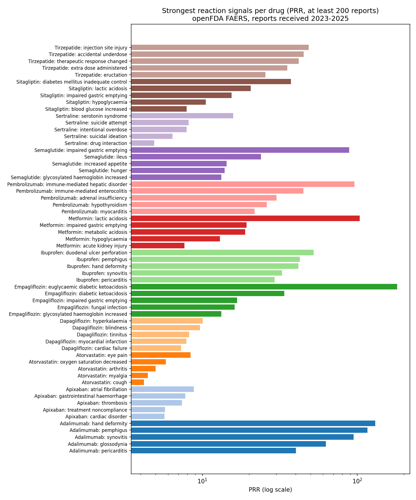
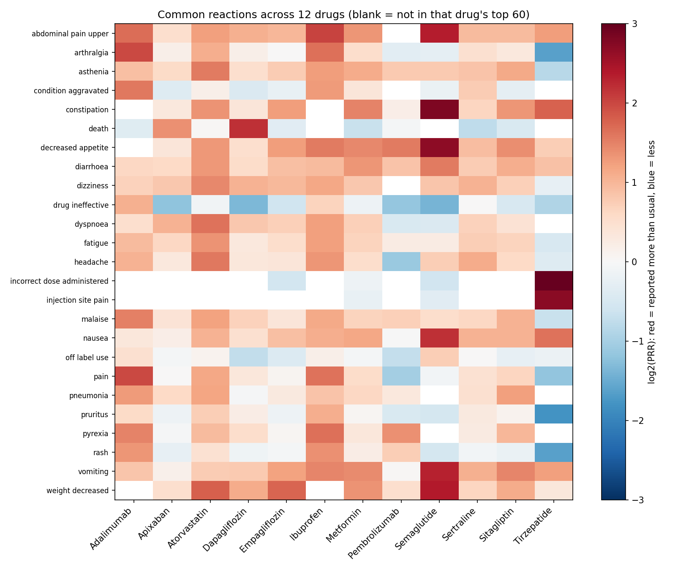
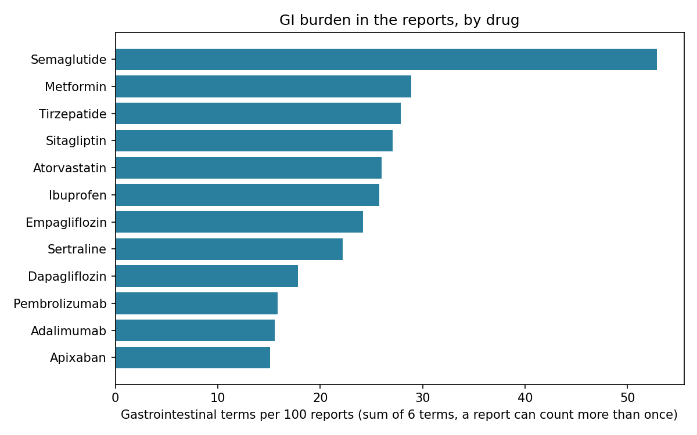

# Drug safety signals in FDA adverse event reports

I wanted to see what a pharmacovigilance team sees when it looks at a pile of adverse event reports: which reactions show up with a drug much more often than they do with everything else. This project does that for 12 common drugs using the public FDA FAERS data.

## Data
- FDA Adverse Event Reporting System (FAERS), through the openFDA API: https://open.fda.gov/apis/drug/event/
- Reports received 2023-01-01 to 2025-12-31 (3,995,473 reports in that window when I pulled it).
- 12 drugs, picked to cover diabetes/obesity, heart, immunology, oncology and common primary care: semaglutide, tirzepatide, metformin, empagliflozin, dapagliflozin, sitagliptin, atorvastatin, apixaban, adalimumab, pembrolizumab, sertraline, ibuprofen.
- For each drug I take its 60 most reported reaction terms (MedDRA preferred terms), then look up how often each term appears in the whole database.

## Method
For each drug and reaction I build the usual 2x2 table (drug yes/no, reaction yes/no) from the counts, then compute:
- PRR (proportional reporting ratio) and ROR (reporting odds ratio), with 95% confidence intervals.
- A pair is flagged as a signal when PRR is at least 2, there are at least 3 reports, and the lower bound of the PRR interval is above 1.

The counts go into a small SQLite database and the 2x2 tables are built with SQL (see `src/analyze.py`). Pandas does the stats, matplotlib and plotly do the charts.

## What came out
Many of the top results match what is already on the drug labels, which is a good sign the method works:
- Empagliflozin: euglycaemic diabetic ketoacidosis (PRR about 181), diabetic ketoacidosis.
- Metformin: lactic acidosis (PRR about 104).
- Semaglutide: impaired gastric emptying (about 89), ileus.
- Pembrolizumab: immune-mediated hepatic disorder, enterocolitis, adrenal insufficiency, hypothyroidism.
- Sertraline: serotonin syndrome, suicide attempt.
- Apixaban: gastrointestinal haemorrhage.

Full tables: `data/signals_all.csv` (every drug-reaction pair) and `data/signals_flagged.csv` (flagged pairs).





Interactive version: open `dashboard.html` in a browser (needs internet for the plotting library).

## Limits (read before quoting any number)
- A signal is not proof that the drug causes the reaction. Reporting is voluntary and uneven, and a high PRR only says the pair is reported together unusually often.
- Confounding by indication: some results come from the disease, not the drug. Adalimumab and "hand deformity" is rheumatoid arthritis showing up in the reports. Tirzepatide's "accidental underdose" and "injection site injury" are about the pen device, not the molecule.
- Some odd pairs (for example ibuprofen and pemphigus) are probably reports that list many drugs, where ibuprofen is not the suspect drug. This analysis counts a drug if it appears anywhere in the report, not only as the suspect drug.
- Drug names are matched on the openFDA generic name field, so brand/ingredient naming can shift counts a little.
- I only looked at each drug's 60 most reported reactions, so rarer signals are not covered.
- The same event can be reported more than once, and FAERS is not deduplicated here.

## Reproduce
```
pip install pandas numpy matplotlib plotly
python src/fetch.py     # about 3-4 minutes, calls the public API
python src/analyze.py   # builds data/faers.db, figures and dashboard.html
```
`fetch.py` stops after about 85 seconds if the API is slow. Just run it again, it keeps what it already pulled.

## What I would do next
Restrict to suspect-drug only reports, compare GLP-1 drugs against each other, and look at reports from Saudi Arabia and the Gulf once the sample is big enough.
